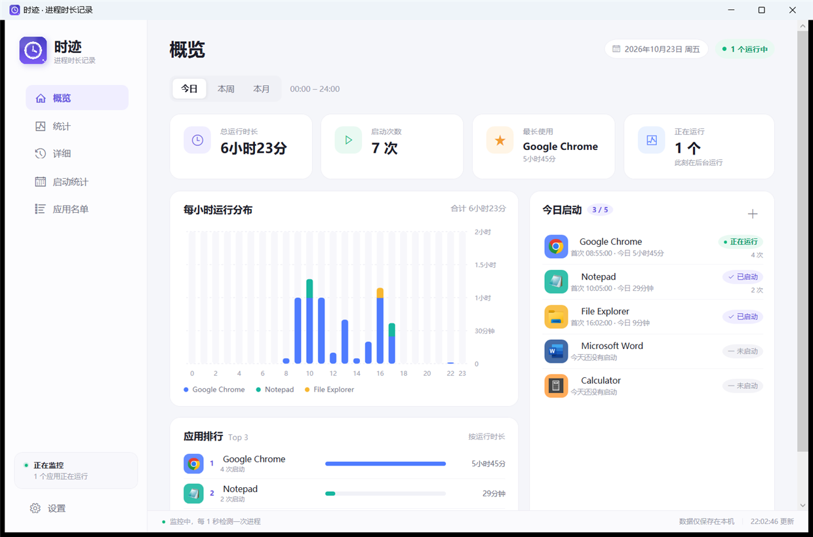
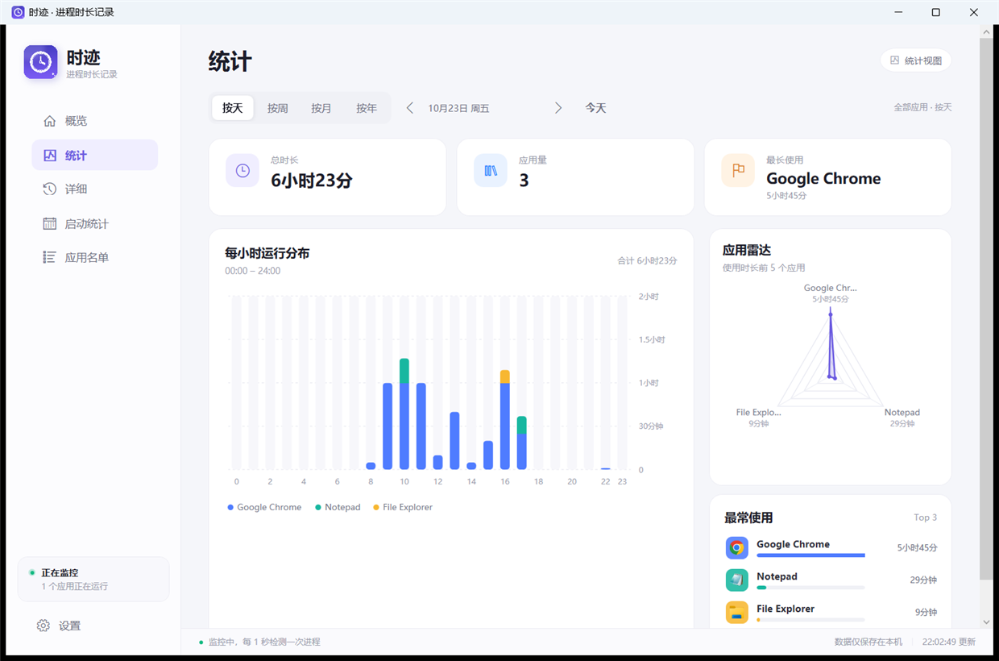
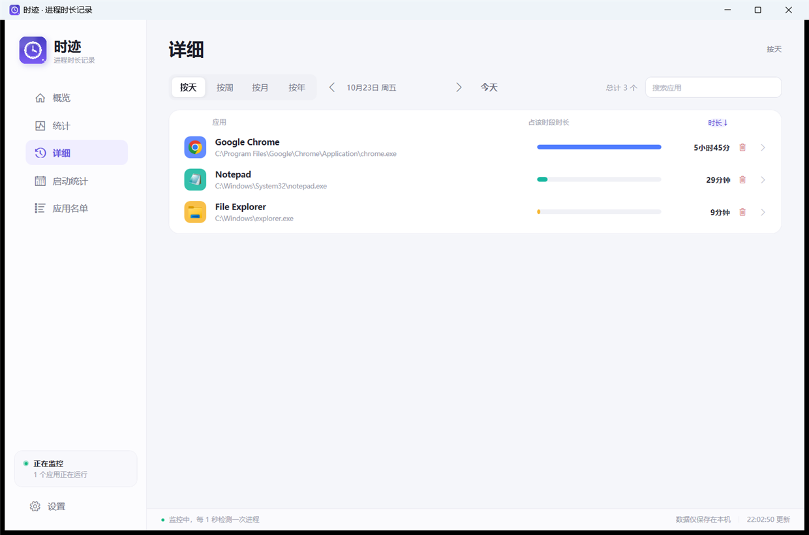
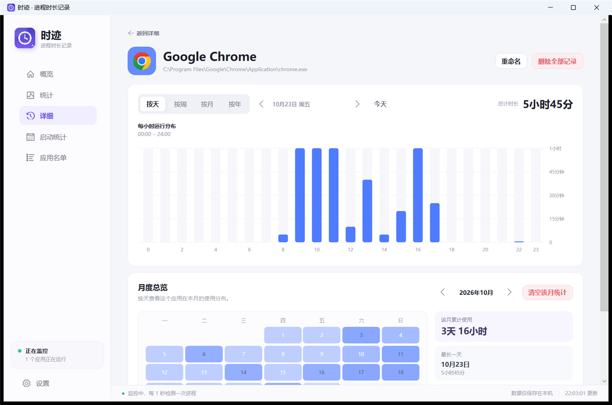
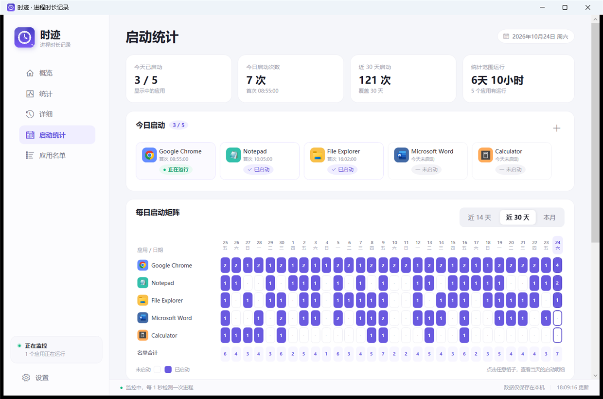
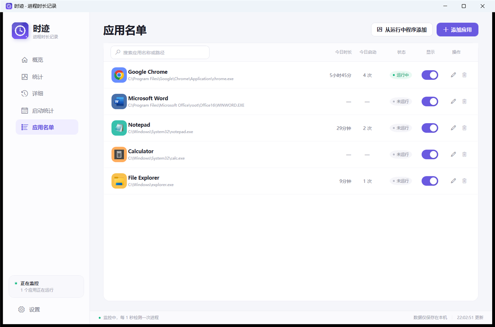

# 时迹 · ShiJi

[](https://github.com/muchengugugu/ShiJi/actions/workflows/build.yml)
[](https://github.com/muchengugugu/ShiJi/releases/latest)
[](LICENSE)

一个原生 Windows 桌面程序，用来记录**名单内程序进程的实际存在时长**。它不是网页版，也不依赖浏览器；界面使用 .NET 8 + WPF 构建。

和只统计前台窗口焦点的工具不同，时迹只看程序进程是否存在：窗口最小化、被其他窗口挡住、藏在托盘里，都继续计时；程序退出后才结束这一段记录。多个程序同时运行时会分别、并行累计。



## 功能

- **按进程计时**：名单内程序只要进程存在就计时，和窗口焦点无关。
- **并行记录**：多个应用同时启动时互不影响，各自独立累计；同一程序多开只合并为一段并记录峰值实例数。
- **统计页**：按天 / 周 / 月 / 年查看总时长、应用量、最长使用、应用雷达（前 5 个应用）、分布柱状图和最常使用的应用。
- **详细页**：按应用汇总所选时间范围内的使用时长和占比，支持搜索、按时长排序。
- **应用详情**：点击详细页里的应用进入独立画面，查看该应用按时段的使用图表、月度日历、当月累计、最长一天和占比。
- **应用雷达**：统计页展示所选时间段内使用时长最多的 5 个应用。
- **删除历史**：详细页每个应用右侧可一键删除该应用的全部历史记录；应用详情里还可以只清空某个月。
- **今日启动看板**：展示应用名单里“显示”开关打开的应用，显示今天是否启动、首次启动时间、启动次数和今日时长；监控和记录始终继续。
- **按天启动统计**：14 天 / 30 天 / 本月启动矩阵，只显示启动次数；近 30 天和本月会按可用宽度压缩列宽和行高，窗口变化时自动重排；矩阵和今日启动只展示在应用名单里打开“显示”的应用。
- **日期边界**：可在设置里选择每天零点或四点作为新的一天；在这个时间之后启动才算新一天，跨边界的运行时长会正确拆分。
- **重命名**：在应用名单点铅笔、在应用详情点“重命名”，或在启动矩阵的应用名上右键，都可以给程序起一个更短的显示名称。
- **概览**：今日 / 本周 / 本月总时长、启动次数、最长使用应用、每小时 / 每日运行分布、应用排行。
- **应用名单**：从文件选择程序，或从正在运行的程序中批量添加；支持显示/隐藏今日启动、重命名、更换图标底色、移出名单；监控默认开启。
- **受保护进程兼容**：优先使用低权限进程路径查询；游戏/反作弊进程拒绝路径读取时，仍会出现在列表里，并可按进程名加入监控。
- **托盘常驻**：关闭窗口默认收进托盘，计时不中断；托盘右键可真正退出。
- **开机自启**：可在设置中开启（写入当前用户启动项）。
- **本地数据**：JSON 保存在 `%APPDATA%\ShiJi\data.json`，自动保留 `.bak` 备份。
- **导出**：详细页可导出 CSV。











## 下载

在 **[Releases](https://github.com/muchengugugu/ShiJi/releases/latest)** 下载最新的 `ShiJi-win-x64.zip`。源码仓库不提交 `dist/`、`bin/`、`obj/` 和用户数据，下载请走 Releases。

## 运行要求

- Windows 10 / 11，x64
- [.NET 8 Desktop Runtime](https://dotnet.microsoft.com/download/dotnet/8.0)（如果电脑尚未安装）

发布目录中的 `ShiJi.exe`、`ShiJi.dll`、`ShiJi.deps.json`、`ShiJi.runtimeconfig.json` 需要放在同一文件夹中，双击 `ShiJi.exe` 启动。数据目录与程序目录分离，升级或移动程序不会丢数据。

## 使用

1. 打开「应用名单」，点「添加应用」选择 `.exe`；也可以点「从运行中程序添加」。
2. 保持时迹运行。加入名单的程序启动后会自动出现一段记录。
3. 在「概览」看今日总量；在「统计」看应用雷达和最常使用；在「详细」按应用查看所选时间段，点应用进入详情；在「启动统计」看按天矩阵。
4. 关闭窗口会收进系统托盘。需要彻底退出时，右键托盘时钟图标选择「退出时迹」。
5. 应用详情里可以按天 / 周 / 月 / 年查看图表，并在「月度总览」里清空某个月。
6. 点击详细页「时长」表头可切换从长到短 / 从短到长；每个应用右侧删除按钮会删除该应用的全部历史记录（需要确认）。
7. 应用名单每行的「显示」开关决定它是否出现在今日启动看板和启动矩阵里；关闭只隐藏展示，监控和记录不会停止。启动矩阵只显示启动次数，不再有启动/时长切换；鼠标放在矩阵上时滚轮仍然滚动整个页面。
8. 在设置 → 时间更新里选择「零点」或「四点」作为每天的分界；选择后今日、矩阵和时长统计会按新的分界重新归组。

## 时长显示

设置 → 显示 → 时长单位有两种模式：

- **自动（天 / 小时）**：超过 24 小时显示“天”，例如 `15天`、`2天 10小时`。
- **小时**：不显示天，把天换算成小时，例如 `360小时`、`58小时10分`。

这个设置影响概览、统计、详细、应用详情等所有时长文字。CSV 导出仍保留完整的日期时间格式。

## 时间更新

设置 → 时间更新可以选择：

- **零点**：每天 00:00 进入新的一天。
- **四点**：每天 04:00 进入新的一天；00:00–03:59 仍算前一天。

这个设置只改变统计时的日期归属，不会修改已经保存的开始/结束时间。应用在分界点之后启动会记入新的一天；跨越分界点的运行时长会按两侧实际重叠时间拆分。

## 添加游戏时看不到？

1. 点开对话框里的 **显示后台进程**：有些游戏的可见窗口属于启动器或子进程，主进程没有窗口，会被折叠在后台列表里。
2. 直接在搜索框输入游戏名、窗口标题或 exe 名。搜索会自动覆盖后台进程，不需要先打开后台列表。
3. 如果对应程序显示 **受保护**，说明 Windows 不允许读取 exe 路径；仍可勾选加入，时迹会保存进程名并按进程名匹配。
4. 如果反作弊完全隐藏了进程，或游戏运行在另一个 Windows 用户会话中，可以改用「添加应用」直接选择游戏 exe，或右键时迹选择「以管理员身份运行」后再从运行中程序添加。

## 计时规则与边界

- 后台每 1 秒枚举一次名单内的进程名，并尽量校验可执行文件完整路径。
- 首次发现程序时开始一段记录；最后那个进程退出时结束这段记录。
- 程序在时迹启动前就已经运行：从时迹开始监控的时刻起算；程序在加入名单时已经运行：从加入名单的时刻起算。
- 同一程序的多个进程（例如 Chrome 的多进程）只算一段，不重复累加时长；会记录峰值实例数。
- 跨午夜的运行时段会按当前设置的日期边界拆分到两天：启动次数记在启动当天，运行时长按每天实际重叠部分统计。
- 冷启动 / 崩溃恢复时，未正常结束的记录会按最后一次心跳时间收尾，最多回退约 30 秒。
- 如果程序由启动器拉起另一个 exe，需要把实际运行的那个 exe 加入名单。
- 某些游戏以管理员权限或反作弊保护运行时，Windows 会拒绝读取 exe 路径。此时列表会显示“受保护”，仍可按**进程名**加入；请确认进程名足够独特，避免误匹配同名程序。
- 1 秒轮询意味着持续不足 1 秒的进程可能漏记。

## 数据

默认位置：

```text
%APPDATA%\ShiJi\data.json
%APPDATA%\ShiJi\data.json.bak
%APPDATA%\ShiJi\error.log
```

如需把数据放到自定义目录（便携使用或测试），可以设置环境变量：

```powershell
$env:SHIJI_DATA_DIR = "D:\ShiJiData"
.\ShiJi.exe
```

应用不联网，也不会上传任何记录。

## 构建

需要 .NET 8 SDK（项目内 `global.json` 固定为 8.0.405）。项目没有第三方 NuGet 依赖。

```powershell
dotnet restore --configfile NuGet.Config
dotnet build -c Release
```

生成发布目录（框架依赖，体积小，需要目标机安装 .NET 8 Desktop Runtime）：

```powershell
dotnet publish -c Release -r win-x64 --self-contained false `
  -p:PublishSingleFile=false `
  -o dist\ShiJi-win-x64
```

如果要完全自包含发布，可在有 NuGet 网络的环境下使用：

```powershell
dotnet publish -c Release -r win-x64 --self-contained true `
  -p:PublishSingleFile=true `
  -o dist\ShiJi-win-x64-selfcontained
```

## 项目结构

```text
ShiJi/
  App.xaml(.cs)             应用入口、单实例、托盘生命周期
  MainWindow.xaml(.cs)      侧边导航、系统托盘、Toast
  Models/                   应用、时段、设置数据模型
  Services/
    DataStore.cs            原子 JSON 持久化、崩溃恢复
    TrackerService.cs       1 秒进程轮询、并行时段管理
    StatsService.cs         日/周/月、按小时、按天聚合
    Periods.cs              按天/周/月/年的时间窗口与柱状图刻度
    StartupManager.cs       开机自启
    CsvExporter.cs          CSV 导出
  Views/                    概览、统计、详细、应用详情、启动统计、应用名单、设置
                             以及“从运行中程序添加”“编辑应用”对话框
  Controls/                 自绘堆叠柱状图、应用雷达图
  Styles/                   主题、按钮、开关、下拉框样式
  docs/                     README 截图
```

## 说明

截图中的数据是为展示界面生成的演示数据，不代表任何真实用户记录。应用默认从空的名单开始。

## 许可证

[MIT License](LICENSE)。
